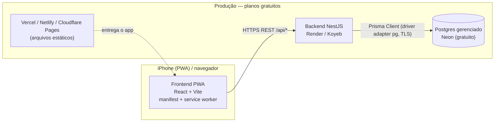

# Arquitetura — App de Hábitos

> ⚠️ **Proposta inicial, a confirmar** (ver `docs/decisoes.md`, 2026-11-25). Descreve a arquitetura herdada do projeto Vivo Team Management. Módulos de domínio e integrações ficam `[A DEFINIR]` até a conversa de requisitos.

## Visão geral

O app é um **PWA** (decisão de 2026-11-25 em `docs/decisoes.md`), instalado no iPhone pelo Safari → "Adicionar à Tela de Início". São dois projetos independentes que se comunicam via REST.



- **Frontend**: SPA React + Vite com manifest e service worker (ex.: `vite-plugin-pwa`). É mobile primeiro e abre em tela cheia (`display: standalone`). Em produção os arquivos estáticos ficam no provedor de frontend. Localmente roda com `vite dev`.
- **Backend**: API NestJS, prefixo global `/api`, Swagger em `/api/docs` (só fora de produção).
- **Banco**: Postgres gerenciado em produção. Localmente roda no container do Docker. As migrations são gerenciadas pelo Prisma (`backend/prisma/migrations/`).
- **Desenvolvimento local**: `docker-compose.yml` na raiz (serviços `postgres`, `backend`, `frontend`). No host, as portas são **5433** (Postgres), **3001** (API) e **5174** (app), diferentes das do Vivo Team Management, para os dois rodarem juntos.
- **Produção**: a Vercel serve o app e repassa `/api` ao backend no Render (`frontend/vercel.json`), então, para o navegador, app e API são o mesmo site. Detalhes em `docs/deploy.md`.
- **Offline**: `[A DEFINIR]`. Em aberto o que o app faz sem internet: só abrir a casca, mostrar dados em cache ou deixar marcar hábitos para sincronizar depois.

## Organização de pastas (alvo)

```
App de Habitos/
├── backend/
│   ├── prisma/
│   │   ├── schema.prisma
│   │   ├── seed.ts              # dados iniciais (idempotente)
│   │   └── migrations/
│   ├── src/
│   │   ├── main.ts              # bootstrap: configureApp + Swagger (só fora de produção)
│   │   ├── app.setup.ts         # configureApp: helmet, CORS, prefixo, ValidationPipe (usado também pelos testes e2e)
│   │   ├── app.module.ts        # registra guards globais
│   │   ├── <dominio>/           # um módulo por domínio — lista [A DEFINIR]
│   │   ├── common/              # decorators, guards, filtros, DTOs e serviços reutilizáveis
│   │   ├── config/              # validação e carregamento de variáveis de ambiente
│   │   ├── database/            # PrismaService (adapter pg)
│   │   └── **/*.spec.ts         # testes unitários, ao lado do arquivo testado
│   ├── test/                    # testes ponta a ponta (*.e2e-spec.ts) + e2e/ (banco de teste, helpers)
│   └── Dockerfile               # multi-stage: build → imagem enxuta, roda `prisma migrate deploy` no start
├── frontend/
│   ├── src/
│   │   ├── components/
│   │   │   ├── ui/              # primitivos no padrão shadcn (Button, Dialog...)
│   │   │   └── layout/          # layouts e casca do app
│   │   ├── pages/               # uma pasta por módulo de negócio
│   │   ├── routes/              # router.tsx, rotas protegidas
│   │   ├── contexts/            # estado global (ex.: sessão)
│   │   ├── services/            # acesso à API (api.ts + um *Service.ts por domínio)
│   │   ├── hooks/               # hooks reutilizáveis
│   │   ├── types/               # tipos TS espelhando os DTOs do backend
│   │   ├── utils/               # funções puras reutilizáveis (ex.: datas)
│   │   └── test/                # setup do Vitest; testes em **/*.test.ts(x)
│   ├── public/                  # ícones do PWA (incl. apple-touch-icon para o iPhone)
│   ├── nginx.conf               # só para o Docker local
│   └── Dockerfile               # só para o Docker local; em produção o provedor faz o build
├── scripts/                     # scripts de operação (backup etc.)
├── docker-compose.yml
├── CLAUDE.md
└── docs/
```

Testes automatizados: ver `docs/padroes.md` → "Testes".

## Fluxo entre frontend e backend

Igual ao Vivo, com a conta única e só senha:

1. O app abre e chama `POST /api/auth/refresh`; o cookie httpOnly vai sozinho. Se a sessão vale, recebe o access token. Se não, vai para `/login`. Se o servidor não responde, mostra "Não foi possível conectar".
2. No login, `POST /api/auth/login` com a senha devolve o access token (que fica em memória) e o cookie com o refresh token.
3. Cada chamada leva `Authorization: Bearer`. Num `401`, o interceptor renova uma vez e repete a chamada. Se a renovação for recusada, volta ao login com o aviso de sessão terminada.

## Responsabilidades por módulo (backend)

| Módulo | Responsabilidade | Status |
|---|---|---|
| `common` | Filtro global de exceção (`filters/`), mensagens de validação em português (`validation/`), decorators (`@Public`, `@Trim`, `@ToBoolean`), "hoje" em Brasília (`utils/brasilia.ts`) | ✅ Etapa 4 |
| `config` | Carregamento e validação das variáveis de ambiente | ✅ Etapa 4 |
| `database` | `PrismaService` (Prisma 7 + adapter pg) | ✅ Etapa 4 |
| `health` | `GET /api/health`: confere API e banco | ✅ Etapa 4 |
| `water` | Módulo Água. Etapa 10: `WaterHistoryService`/`WaterHistoryController` (calendário do mês, sequência, percentual; totais por dia com `groupBy`). Etapa 9: `WaterJobsController` (`POST /jobs/water-reminders`, protegido por `X-Cron-Secret`), `WaterReminderDispatchService` (janela de 10 min, uma vez por dia, pula lembrete já tomado), `ReminderCache` (lembretes em memória). Etapa 8: `WaterTodayService`/`WaterTodayController` (resumo do dia, "tomei", registro livre, desfazer só hoje). Etapa 7: meta diária (histórico por dia), lembretes (CRUD com exclusão lógica), soma × meta. Usa `Clock` (`common/services/clock.service.ts`) para "hoje" em Brasília | ✅ Etapa 7 |
| `push` | Web Push: inscrições por aparelho (`push_subscriptions`), status/chave pública, teste, envio para todos com limpeza das inscrições expiradas. `PushSender` isola a biblioteca `web-push` | ✅ Etapa 9 |
| `auth` | Login só por senha, refresh opaco e rotativo, logout, `JwtAuthGuard` global, `AccountBootstrapService` (conta única a partir de `ADMIN_PASSWORD` no boot) | ✅ Etapa 5 |
| `[A DEFINIR]` | Módulos de domínio após a conversa de requisitos | — |

## Responsabilidades por módulo (frontend)

| Pasta | Responsabilidade |
|---|---|
| `services/api.ts` | Instância Axios: access token em memória, renovação automática em 401 (uma por vez), aviso de sessão expirada |
| `services/authService.ts` / `healthService.ts` | `login`, `refreshSession`, `logout` / `getHealth` |
| `contexts/AuthContext` | Estado da sessão: `checking` / `offline` / `authenticated` / `anonymous` |
| `routes/` | `router.tsx` (`/login`, `/` protegida) e `ProtectedRoute` |
| `pages/auth/LoginPage` | Tela de senha |
| `sw.ts` | Service worker próprio (`injectManifest`): precache, `push` → notificação, toque → abre o app |
| `lib/push.ts` / `services/pushService.ts` / `pages/water/NotificationsCard` | Suporte do navegador (iPhone só com o app instalado), permissão, inscrição e cancelamento; card na configuração com "Ativar notificações", "Enviar teste" e "Desativar" |
| `pages/home/ModulePickerPage` | Tela inicial (`/`): escolha de módulo (Água, Tarefas) e "Sair deste aparelho". Módulo novo = mais um item em `MODULES` |
| `components/layout/AppShell` | Casca de um módulo: "‹ Módulos" no topo e barra inferior com as abas recebidas por `tabs` (destaque deslizante). Abas em `components/layout/moduleTabs.ts` (`WATER_TABS`) |
| `components/ui/toast` | Aviso escuro acima da barra, com "Desfazer" opcional (`useToast`) |
| `pages/water/todayModel.ts` | Funções puras: lembrete da vez (`nextReminder`) e linha "Seu dia" (`buildTimeline`) |
| `pages/water/WaterTank` | Água animada do tanque (ondas, bolhas, "+X mL", comemoração da meta) |
| `pages/water/GoalCard` / `ReminderSheet` / `NotificationsCard` | Meta com −/+ 250 mL; painel de criar/editar/excluir lembrete; chave de notificações com "Enviar teste" |
| `pages/water/WaterHistoryPage` | `/agua/historico?mes=AAAA-MM`: sequência, % do mês, calendário verde/vermelho (domingo primeiro), navegação entre meses, detalhe do dia. Mês na URL via `hooks/useUrlParam` |
| `pages/water/WaterTodayPage` | Tela Hoje da Água (`/agua`): Água do dia, com `WaterProgress` (total × meta) e `FreeIntakeForm` (+200/+300/+500 e outro valor), "Tomei", registros de hoje com "Desfazer", "Configurar" e "Sair". Recarrega ao voltar para o app (`visibilitychange`) |
| `pages/water/` | `WaterSettingsPage` (`/agua/configuracao`), `GoalForm`, `ReminderForm` (adicionar/editar), `ReminderItem` (editar, excluir com confirmação), `RemindersSummary` (soma × meta e aviso), `waterRules.ts` (limites e esquemas zod iguais aos do backend) |
| `components/ui/` | `Button` (com `loading`), `Input` (16px, sem zoom no iPhone) |
| `services/*Service.ts` | Um arquivo por domínio, funções que chamam a API e tipam a resposta |
| `pages/<dominio>/` | `[A DEFINIR]` |

## Integrações e infraestrutura

- **Hospedagem**: planos gratuitos (ver `docs/deploy.md`).
- **Lembretes/notificações**: `[A DEFINIR]`. No iPhone, push em PWA exige iOS 16.4+ e o app instalado na tela de início. Os jobs agendados também sofrem com o backend gratuito que "dorme".
- Armazenamento de arquivos e serviços externos: `[A DEFINIR]`.

## Diagrama de dependências entre módulos (backend)

`[A DEFINIR]` — criar quando os módulos existirem. Regra herdada: um módulo que precisa ler a tabela de outro consulta via `PrismaService` no próprio repository, sem importar o módulo vizinho, para evitar dependência circular.
