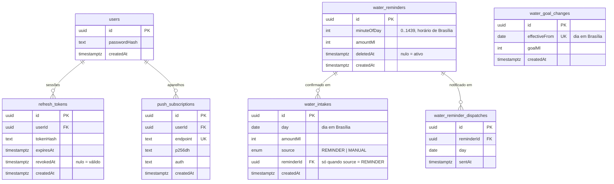

# Banco de Dados — App de Hábitos

PostgreSQL 16 (Neon, plano gratuito, em produção; container do Docker em desenvolvimento). O schema ficará em `backend/prisma/schema.prisma`. Este documento resume entidades, relacionamentos e regras de integridade. Sempre atualizar quando o schema mudar.

> Modelagem aprovada na Etapa 3 (2026-11-25). Schema em `backend/prisma/schema.prisma` desde a Etapa 4.

## Migrations aplicadas

| Migration | O que faz |
|---|---|
| `20261126233900_task_reminder_dispatches` | Tabela `task_reminder_dispatches` (Etapa 15): marca o lembrete de uma tarefa enviado num dia |
| `20261126232139_task_recurrence` | `tasks.repeatDays` e a tabela `task_repeat_changes` (Etapa 14), com os `CHECK` dos dias (1..127), recorrente sem data e horário com data ou repetição |
| `20261126223549_tasks` | Cria `tasks` e `task_completions` (Etapa 13), com os `CHECK` em SQL bruto (título não vazio, horário 0..1439, horário só com data) |
| `20261125130000_refresh_token_hash_unique` | `refresh_tokens.tokenHash` passa a ser único (busca do token pelo hash, Etapa 5) |
| `20261125120000_init` | Cria as 7 tabelas, o enum `WaterIntakeSource`, as FKs e, em SQL bruto, os `CHECK` (valores positivos, horário 0..1439, `source` × `reminderId`) e os índices únicos parciais (lembrete ativo por horário; confirmação por lembrete e dia) |

## Diagrama



## Entidades

### Acesso

- **`users`**: uma linha só, criada **no boot do backend** (`AccountBootstrapService`) com o hash bcrypt da senha lida de variável de ambiente (`ADMIN_PASSWORD`). Não há e-mail nem nome de usuário. O login é só pela senha.
- **`refresh_tokens`**: guarda o hash SHA-256 do refresh token opaco (nunca o valor), com rotação a cada uso. `tokenHash` é único. Logout ou rotação preenchem `revokedAt`.
- **`push_subscriptions`**: uma linha por aparelho ou navegador que aceitou notificações (dados do Web Push). `endpoint` é único. Se o serviço de push responder que a inscrição expirou (404/410), a linha é apagada.

### Módulo Água

- **`water_goal_changes`**: histórico da meta diária. **A meta de um dia D é a da linha com o maior `effectiveFrom` ≤ D.** Mudar a meta cria uma linha com `effectiveFrom` = hoje. Se já existe uma linha para hoje, ela é atualizada (único por `effectiveFrom`). Assim, dias passados nunca mudam de meta.
- **`water_reminders`**: lembretes, iguais todos os dias.
  - O horário é guardado como minuto do dia (ex.: 08:30 = 510), no horário de Brasília.
  - Excluir um lembrete é exclusão lógica (`deletedAt`), para não quebrar os registros antigos que apontam para ele.
  - A soma de `amountMl` dos lembretes ativos é comparada com a meta para mostrar o aviso de "não vai bater a meta". Isso é calculado, não guardado.
- **`water_intakes`**: cada registro do que foi bebido.
  - `day` é o dia em Brasília em que o registro foi feito, e a quantidade fica gravada no próprio registro. Se o lembrete mudar de quantidade depois, o histórico não muda.
  - `source = REMINDER` exige `reminderId`; `source = MANUAL` exige `reminderId` nulo.
  - Só é possível criar ou apagar registros com `day` = hoje. Essa regra fica no service, e o banco não aceita `day` futuro.
- **`water_reminder_dispatches`**: marca que a notificação de um lembrete foi enviada num dia. O único (`reminderId`, `day`) garante **uma notificação só por lembrete por dia**, mesmo que o cron chame o backend várias vezes ou duas chamadas se cruzem.

### Módulo Tarefas (Etapa 13, aprovada em 2026-11-26)

Só as tarefas avulsas. As recorrentes (Etapa 14) e o envio dos lembretes (Etapa 15) ganham colunas e tabelas nas etapas delas.

- **`tasks`**: `id` uuid, `title` varchar(120), `dueDate` date nulo (sem data), `dueMinuteOfDay` int nulo (0..1439, horário de Brasília, só com `dueDate`), `deletedAt` (exclusão lógica), `createdAt`, `updatedAt`.
- **`task_completions`**: `id` uuid, `taskId` FK, `day` date (dia em Brasília em que foi concluída), `completedAt` timestamptz. Única por (`taskId`, `day`). Para a tarefa avulsa, o service garante uma conclusão só. A tabela já serve às recorrentes (uma conclusão por ocorrência e dia) e ao histórico (concluídas por dia = contagem por `day`).
- Regras no banco: `CHECK (dueMinuteOfDay BETWEEN 0 AND 1439)`, `CHECK (dueMinuteOfDay IS NULL OR dueDate IS NOT NULL)`, `CHECK (char_length(trim(title)) BETWEEN 1 AND 120)`.
- Calculado, sem guardar: **Hoje** = sem data ou com data de hoje, não concluídas, mais as concluídas hoje (riscadas). **Próximas** = data futura, não concluídas. **Atrasadas** = data antes de hoje e não concluídas.

### Módulo Tarefas: recorrentes (Etapa 14, aprovada em 2026-11-26)

- **`tasks.repeatDays`** smallint nulo: dias da semana em que a tarefa se repete, como soma de bits (domingo = 1, segunda = 2 … sábado = 64; todo dia = 127). Nulo = avulsa. Recorrente não tem `dueDate`; o horário (`dueMinuteOfDay`) é opcional e vale para todas as ocorrências.
- **`task_repeat_changes`**: `taskId`, `effectiveFrom` date, `repeatDays`. Histórico dos dias da semana, como a meta da Água: os dias de uma recorrente no dia D são os da linha com o maior `effectiveFrom` ≤ D. Único por (`taskId`, `effectiveFrom`). Mudar os dias cria ou atualiza a linha de hoje, então os dias passados continuam com a regra que valia neles (o histórico da Etapa 16 usa isso).
- **Ocorrência** não é guardada: é calculada pelo dia da semana. A conclusão de uma ocorrência é uma linha em `task_completions` com `day` = o dia dela (o único por tarefa e dia já existe).
- A recorrente começa no dia em que é criada (`createdAt` em Brasília) e para no dia da exclusão (`deletedAt` em Brasília, que já não conta).
- Regras no banco: `CHECK (repeatDays BETWEEN 1 AND 127)`, `CHECK (repeatDays IS NULL OR dueDate IS NULL)` e o horário passa a valer com data **ou** repetição.

### Módulo Tarefas: lembretes (Etapa 15)

- **`task_reminder_dispatches`**: `taskId`, `day`, `sentAt`. Marca que o lembrete da tarefa saiu num dia; o único (`taskId`, `day`) garante uma notificação só por tarefa por dia, como `water_reminder_dispatches`.

### Valores calculados (não guardados)

- **Total do dia** = soma de `water_intakes.amountMl` do dia.
- **Quanto falta** = max(0, meta do dia − total do dia).
- **Meta batida** = total ≥ meta do dia.
- **Calendário, sequência e percentual do mês**: agregação por `day` cruzada com a meta de cada dia. Não há tabela de resumo, porque o volume de um único usuário é pequeno.

## Regras de integridade no banco

| Regra | Como |
|---|---|
| Uma meta por dia de vigência | `UNIQUE (effectiveFrom)` em `water_goal_changes` |
| Meta e quantidades positivas | `CHECK (goalMl > 0)`, `CHECK (amountMl > 0)` (SQL bruto na migration) |
| Horário válido | `CHECK (minuteOfDay BETWEEN 0 AND 1439)` |
| Não ter dois lembretes ativos no mesmo horário | índice único parcial em `minuteOfDay WHERE deletedAt IS NULL` (SQL bruto) |
| Lembrete confirmado uma vez por dia | índice único parcial em (`day`, `reminderId`) `WHERE reminderId IS NOT NULL` (SQL bruto) |
| `source` coerente com `reminderId` | `CHECK` na migration |
| Tarefa: título não vazio, horário 0..1439 e só com data | `CHECK` em `tasks` (SQL bruto) |
| Recorrente: dias 1..127, sem data; horário só com data ou repetição | `CHECK` em `tasks` e `task_repeat_changes` (SQL bruto) |
| Uma regra de dias por recorrente e dia de vigência | `UNIQUE (taskId, effectiveFrom)` em `task_repeat_changes` |
| Um lembrete de tarefa por tarefa e dia | `UNIQUE (taskId, day)` em `task_reminder_dispatches` |
| Uma conclusão por tarefa e dia | `UNIQUE (taskId, day)` em `task_completions` (a avulsa só tem uma: garantido no service) |
| Uma notificação por lembrete por dia | `UNIQUE (reminderId, day)` em `water_reminder_dispatches` |

## Enums

| Enum | Valores |
|---|---|
| `WaterIntakeSource` | `REMINDER` (confirmou um lembrete), `MANUAL` (registro livre) |

## Convenções do schema

- Tabelas em `snake_case` via `@@map`, models em `PascalCase`, enums em `SCREAMING_SNAKE_CASE`.
- Ids `uuid`.
- Instantes em `timestamptz`. "Dias" de negócio em `date`, já convertidos para o dia de Brasília pelo backend.
- Regras que o Prisma não expressa (índice único parcial, `CHECK`) vão em SQL bruto dentro da migration.

## Rodando migrations

```bash
# aplicar migrations pendentes (produção/CI)
npx prisma migrate deploy

# criar uma nova migration a partir de mudanças no schema.prisma (dev)
npx prisma migrate dev --name <nome>

# rodar o seed (idempotente)
npx prisma db seed
```
